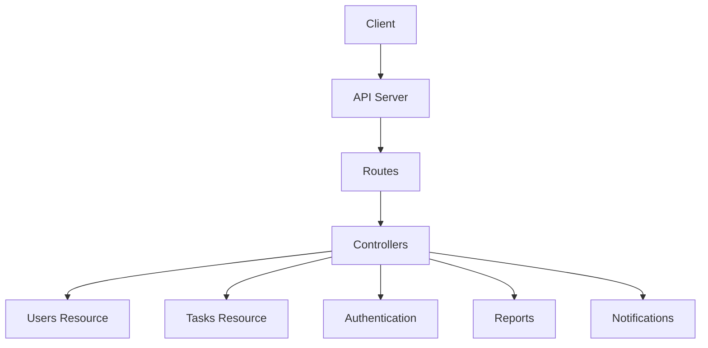

# System Architecture
## Smart Team Task Manager

### Architecture Diagram

### Components Description

1. Client: ارسال درخواست‌ها به سرور
2. API Server: دریافت و مدیریت درخواست‌ها
3. Routes: تعیین مسیر درخواست‌ها
4. Controllers: پردازش درخواست‌ها
5. Users: مدیریت اطلاعات کاربران
6. Tasks: مدیریت وظایف
7. Authentication: احراز هویت
8. Reports: تولید گزارش
9. Notifications: ارسال اعلان

### Request Flow

Client → API Server → Routes → Controllers → Resources

### Conclusion

این معماری باعث جداسازی مسئولیت‌ها و ساده‌تر شدن توسعه و نگهداری پروژه می‌شود.
